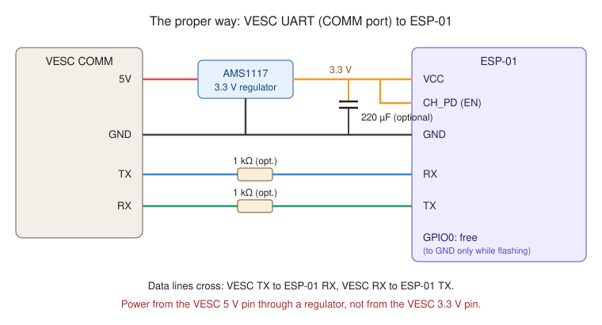
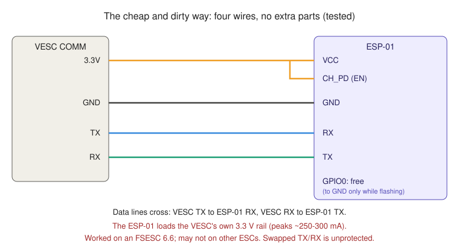

# vesc-esp01-wifi-bridge

**The cheapest way we know of to talk to your VESC wirelessly.** A ~€1–2 ESP-01 (ESP8266) module turns your VESC's UART into a WiFi link, so VESC Tool on your phone or laptop can read live data and change settings with no USB cable and no €20 Bluetooth module.

- Live real-time data, trip stats and full configuration from the VESC Tool phone app.
- About €3 in parts, including the regulator, capacitor and resistors, plus a ~€1–3 USB programmer to flash it once (see below).
- Lets you seal the ESC away from the weather. You don't need to reach its USB port.
- Tested on a Flipsky FSESC 6.6 (VESC 6) on an e-bike, with VESC Tool on Android over TCP. Solid connection while riding.

> **Do not upload VESC firmware over this link.** A WiFi dropout during a firmware update can brick your ESC. Use USB for firmware updates.

## How it works

The ESP-01 runs its own WiFi access point and a TCP server on port 65102, VESC Tool's default. Every byte from VESC Tool goes unchanged to the VESC's UART, and every byte back goes to VESC Tool. The VESC can't tell the difference from a cable.

## Parts

| Part | Notes |
|---|---|
| ESP-01 or ESP-01S module | ESP8266, 1 MB flash |
| AMS1117 3.3 V regulator module | Optional. Powers the ESP-01 from the VESC's 5 V instead of its 3.3 V pin |
| 220 µF electrolytic capacitor, 10 V or more | Optional. At the ESP-01's VCC/GND pins, for WiFi current peaks |
| 2 × 1 kΩ resistors | Optional. In series with TX and RX. They protect both sides if TX and RX get swapped |
| **Programmer** (one-time tool) | **Needed to load the firmware into the ESP-01.** See below |

### You need a programmer to flash the ESP-01

The ESP-01 has no USB port, so you need a small USB programmer to load the firmware. You only need it once; it isn't part of the finished bridge. Either:

- **An ESP-01 USB programmer** (CH340-based, about €1–3). The ESP-01 plugs straight into it. **Buy the version with a PROG/UART switch**, which connects GPIO0 to GND for flashing. Without the switch you have to add a wire or a button from GPIO0 to GND yourself.
- **A generic 3.3 V USB-serial adapter** (FT232RL, CH340 or CP2102) with jumper wires, wired as described under [Build and flash](#build-and-flash).

Including a programmer, the whole setup is still only about €4–6.

The bridge works without the regulator, the capacitor and the resistors; it was tested on the bike with just four wires (see [the cheap and dirty way](#the-cheap-and-dirty-way-four-wires-tested)). They're cheap insurance: the regulator keeps the ESP-01's current peaks off the ESC's own 3.3 V rail, the resistors make a swapped TX/RX harmless, and the capacitor smooths the supply when the WiFi transmits.

## Wiring

Two options: the proper way, and the cheap and dirty way. Both are tested.

### The proper way



| VESC COMM port | ESP-01 |
|---|---|
| 5V | AMS1117 input; the AMS1117 3.3 V output goes to ESP-01 **VCC** and **CH_PD** |
| GND | GND (also the AMS1117 GND) |
| TX | **RX**, through 1 kΩ |
| RX | **TX**, through 1 kΩ |

- **Power the ESP-01 from 5 V through the regulator, not from the VESC's 3.3 V pin.** The ESP-01 draws peaks of about 250–300 mA when transmitting. The VESC's 3.3 V rail also feeds its own processor and your throttle, and a dip there can cause throttle jitter or an ESC reset.
- **CH_PD (EN) must be at 3.3 V,** or the ESP-01 stays switched off. The ESP-01S has a pull-up on the board, but the original ESP-01 often doesn't.
- **On VESC 6-style COMM ports** (such as the FSESC 6.6: 5V, 3.3V, GND, ADC1, RX, TX, ADC2, ADC3), an ADC throttle can stay on the same port. Check your own ESC's pinout, since connectors differ between models.

### The cheap and dirty way (four wires, tested)



| VESC COMM port | ESP-01 |
|---|---|
| 3.3V | **VCC** and **CH_PD** |
| GND | GND |
| TX | **RX** |
| RX | **TX** |

This works: it ran on a Flipsky FSESC 6.6 on the bike with a solid connection. It's the cheapest possible setup, just the ESP-01 and four wires. The risks:

- **The ESP-01 loads the VESC's 3.3 V rail.** Its WiFi peaks of about 250–300 mA come from the same regulator that powers the VESC's processor and your throttle. On the FSESC 6.6 that was fine; on an ESC with a weaker 3.3 V regulator it could cause throttle jitter or an ESC reset while riding. If you see either, switch to the proper way above.
- **No protection on the data lines.** If TX and RX are wired straight instead of crossed, two outputs drive each other with nothing to limit the current.

A good middle ground is to keep the four wires but add the 220 µF capacitor at the ESP-01's VCC and GND pins, and set `WIFI_TX_DBM` to 10 (the default), which lowers the current peaks.

### Finding the ESP-01 pins

The ESP-01 has no pin labels. The header is two rows of four:

```
row A:  GND    GPIO2   GPIO0   RX
row B:  TX     CH_PD   RST     VCC
```

GND and VCC are at diagonally opposite corners. To find GND with a multimeter, look at the small 8-pin flash chip: its pin 4 is GND and pin 8 is VCC (pin 1 is marked by a dot). The header pin that beeps to flash pin 4 is GND, and the rest follow from the layout above.

## VESC Tool settings

1. **App Settings > General > App to Use:** `UART`. If you also use an ADC throttle, choose `ADC and UART`, and the throttle keeps working.
2. **App Settings > UART > Baudrate:** `115200` (must match `VESC_BAUD`).
3. Write the app configuration.

## Build and flash

1. Install [PlatformIO](https://platformio.org/).
2. **Edit `platformio.ini`:** set `WIFI_SSID` and **your own `WIFI_PASS`** (8–63 characters). The build refuses to compile while the password is still `CHANGE_ME`. Anyone who knows the password can change your ESC's settings, including current limits, so use a strong one.
3. Connect the ESP-01 to your programmer:
   - **ESP-01 USB programmer:** plug the ESP-01 in and set the switch to **PROG** (GPIO0 to GND).
   - **Generic USB-serial adapter:** adapter TX to ESP RX, adapter RX to ESP TX, GND shared, VCC and CH_PD to 3.3 V, **GPIO0 to GND**.
4. Plug the programmer into USB (the ESP-01 must power up with GPIO0 on GND), then run:

```
pio run -t upload
```

5. Set the switch back to **UART** (or remove the GPIO0-to-GND link) and power-cycle. The ESP-01 now runs the bridge; take it out of the programmer and wire it to the VESC.

### Flashing tips

- **Don't power the ESP-01 from the adapter's 3.3 V pin.** It usually can't supply the current, and flashing fails or the adapter resets. Use a separate 3.3 V supply (a regulator, or a Li-ion cell through a silicon diode such as a 1N4007) with GND shared.
- **"No serial data received":** GPIO0 wasn't on GND when the ESP-01 powered up, CH_PD isn't high, or TX and RX aren't crossed.
- **macOS doesn't show a serial port for an FT232RL adapter:** some counterfeit FT232R chips report product ID `0x0000`, and macOS ignores them. Their product ID can be restored to `0x6001` with [pyftdi](https://eblot.github.io/pyftdi/).

## Connect

1. Join the WiFi network you set in `WIFI_SSID`. Your phone may warn about no internet access; stay connected.
2. In VESC Tool: **Connection > TCP**, address `192.168.4.1`, port `65102`.

## Configuration

All settings are build flags in `platformio.ini`:

| Flag | Default | Meaning |
|---|---|---|
| `WIFI_SSID` | `VESC-Bridge` | Network name |
| `WIFI_PASS` | `CHANGE_ME` (refused) | WPA2 password, 8–63 characters |
| `WIFI_TX_DBM` | `10.0` | Transmit power, 0–20.5 dBm. Lower means smaller current peaks; 10 dBm reaches a phone on the handlebar easily. |
| `VESC_BAUD` | `115200` | UART baud rate, must match VESC Tool |
| `TCP_PORT` | `65102` | VESC Tool's default TCP port |

## Related

- [Vesc_WIFI](https://github.com/NetworkDir/Vesc_WIFI): the same idea for the ESP32.

## Licence

MIT. See [LICENSE](LICENSE).
